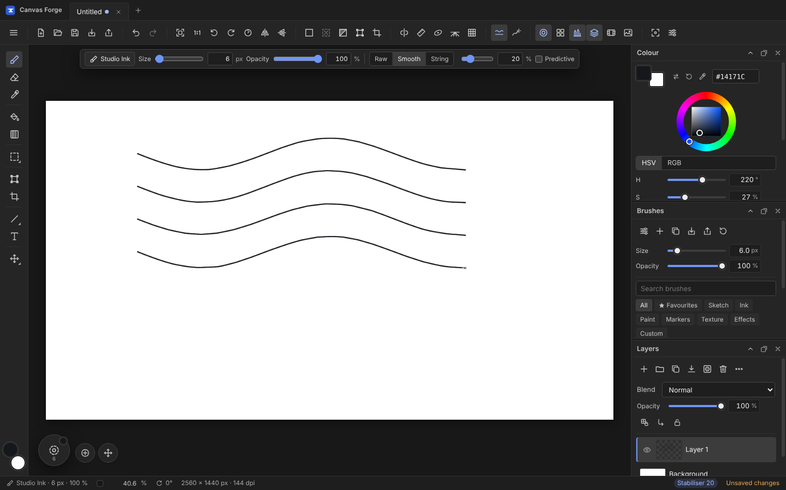
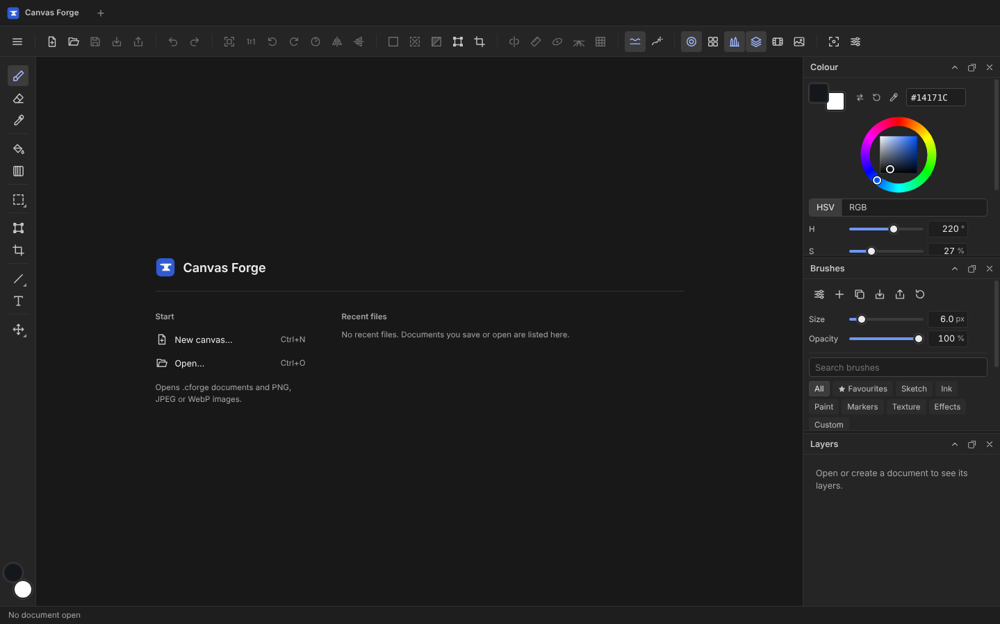
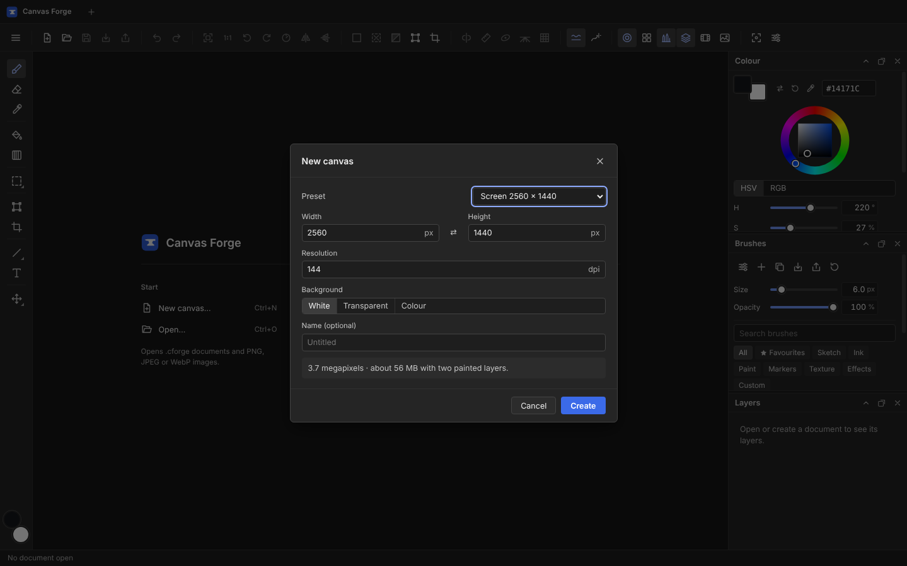
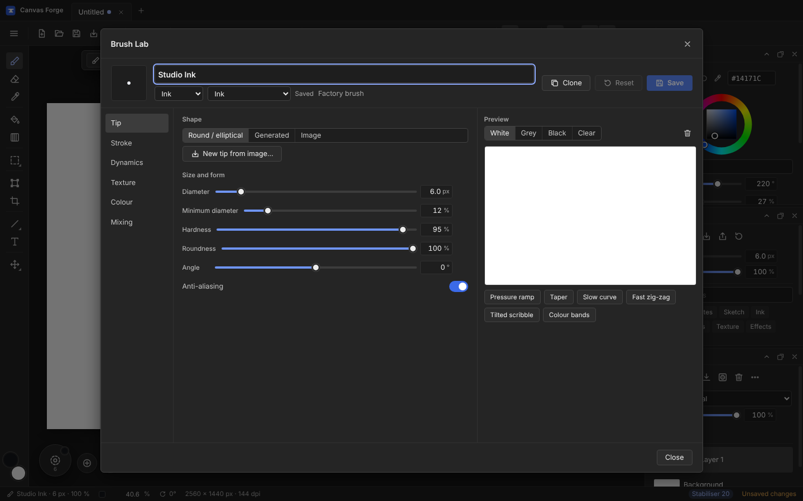

# Canvas Forge

**Raster drawing and painting for pen tablets.**

Canvas Forge is an offline raster drawing and painting application for Windows 11, built with Electron, React and TypeScript on an original tiled pixel engine. No account, no telemetry, no network access; artwork stays on your computer.

> Status and verified results: see [PROGRESS.md](PROGRESS.md). User documentation: [USER_GUIDE.md](USER_GUIDE.md).



## Install

Canvas Forge is installed like any other desktop app; there is no portable or "run from the download" version.

**Latest release:** open [Releases](https://github.com/justusvoelkle3141592654-ux/SketchDrawFinal/releases), download the file for your system and run it.

**Latest build of any branch:** open the repository's **Actions** tab → **Build installers** → the newest green run → **Artifacts** at the bottom of the page. GitHub delivers each artifact as a ZIP; unzip it and run the file inside. Artifacts are kept for 30 days. **Run workflow** on the same page starts a fresh build.

| System | File | Install | Uninstall |
|---|---|---|---|
| Windows 10/11 x64 | `Canvas Forge Setup <version>.exe` (artifact `Canvas-Forge-Windows-Installer`) | Run it, choose *only for me* or *all users*. Adds a Start menu entry, an optional desktop shortcut and the `.cforge` file association. The installer is not code-signed, so SmartScreen may warn: **More info** → **Run anyway**. | Settings → Apps → Canvas Forge → Uninstall |
| Android 7 or newer (tablet with pen recommended) | `canvas-forge-<version>.apk` (artifact `Canvas-Forge-Android-APK`) | Download it on the device and open it; Android asks once to allow installs from the browser or file manager. Documents are saved in *Documents/Canvas Forge*, exports in *Documents/Canvas Forge/Exports*. | Hold the app icon → App info → Uninstall |
| Ubuntu / Debian x64 | `canvas-forge_<version>_amd64.deb` (artifact `Canvas-Forge-Linux-deb`) | Open it with the software installer, or `sudo apt install ./canvas-forge_<version>_amd64.deb`. Adds Canvas Forge to the application menu. | `sudo apt remove canvas-forge` |

macOS and iOS are not built.

**Android notes:** the APK is the same interface in an Android WebView (Capacitor), made for tablets; on phones the panels start hidden and open from the command bar. Saving asks for a name and writes to *Documents/Canvas Forge*; documents there appear under *Recent files*. Without the optional signing secrets (`ANDROID_KEYSTORE_BASE64`, `ANDROID_KEYSTORE_PASSWORD`, `ANDROID_KEY_ALIAS`, `ANDROID_KEY_PASSWORD`) the APK is signed with a debug key of the build machine, so a newer APK may have to be installed after uninstalling the old one (documents in *Documents/Canvas Forge* stay).

## Requirements

* Node.js 22 and npm 10
* Windows 10/11 x64 to run the packaged app (development also works on Linux and macOS)

## Commands

| Command | What it does |
|---|---|
| `npm install` | Installs dependencies. The project-local `.npmrc` sets `legacy-peer-deps=true` (works around an npm 10 crash while resolving Vitest's optional peers). If `node_modules/electron/dist` is missing afterwards, run `node node_modules/electron/install.js`. |
| `npm run dev` | Vite dev server + esbuild watch + Electron |
| `npm run build` | Production build into `dist/` |
| `npm start` | Build and launch Electron |
| `npm run lint` | ESLint (zero warnings allowed) |
| `npm run typecheck` | TypeScript for renderer, main/preload and tests |
| `npm test` | Unit tests (Vitest) |
| `npm run test:e2e` | Build, then Electron + Playwright smoke test (uses `xvfb-run` automatically on Linux without a display) |
| `npm run perf` | Engine benchmarks (prints timings) |
| `npm run package:win` | Windows NSIS installer into `release/` (on Linux this needs Wine, including 32-bit support, for the NSIS uninstaller stub and the executable's icon/version resources; on Windows no extra tools are needed) |
| `npm run package:linux-dir` | Unpacked Linux build (used to launch-test the packaged app on Linux) |
| `npm run package:linux-deb` | Linux `.deb` installer package (x64) into `release/` |
| `npm run package:android` | Debug APK into `android/app/build/outputs/apk/debug/` (needs JDK 21 and the Android SDK with platform 36; set `ANDROID_HOME` or `android/local.properties`) |
| `npm run package:linux-appimage` | Linux AppImage (x64) into `release/` (not published by CI) |

## Builds and releases

`.github/workflows/build.yml` runs on every push, on pull requests and from the **Run workflow** button: lint, typecheck and unit tests, then the Windows installer on a Windows runner, the `.deb` on Linux (installed, checked and removed again on the runner) and the Android APK (installed in an Android 15 tablet emulator, where Playwright drives the app's WebView: it opens a canvas, draws a finger stroke and checks that it reached the layer). All are attached to the run as artifacts. Pushing a tag such as `v1.0.3` (or `v1.0.3-beta.1`) additionally sets the version from the tag and publishes the installers and the APK as a GitHub Release (tags with a `-` suffix become pre-releases).

`scripts/render-icons.mjs` regenerates `build/icon.png` and `build/icon.ico` from `build/icon.svg` (needs Playwright's Chromium and ImageMagick).

## Project layout

```
src/main/       Electron main process (windows, dialogs, atomic file IO, app data, recovery)
src/preload/    sandboxed preload exposing the typed `window.forge` API
src/shared/     IPC contract and .cforge validation shared by main and renderer
src/renderer/   React UI, Zustand stores, pixel engine, tools
tests/unit/     engine unit tests
tests/e2e/      Electron smoke test
tests/perf/     engine benchmarks
docs/           architecture, file format, performance, tablet testing
build/          original icon sources and generated icons
reference/ui/   third-party reference screenshots (research only, never packaged)
```

## Screenshots

| Start | New canvas | Brush Lab |
|---|---|---|
|  |  |  |

## Documentation

* [PLAN.md](PLAN.md) — architecture plan, milestones, risks, trade-offs
* [docs/architecture.md](docs/architecture.md) — processes, engine, compositing and colour policy
* [docs/file-format.md](docs/file-format.md) — `.cforge` and `.cforge-brushpack`
* [docs/performance.md](docs/performance.md) — measured engine performance
* [docs/tablet-testing.md](docs/tablet-testing.md) — manual hardware checklist and tested status
* [THIRD_PARTY_NOTICES.md](THIRD_PARTY_NOTICES.md) — licences

## Originality

The name Canvas Forge, its icon, interface design, icon set, brush presets, textures and palettes are original. The application is not affiliated with, or a reproduction of, any other drawing product. The screenshots in `reference/ui/` were used only to study general workflow.
